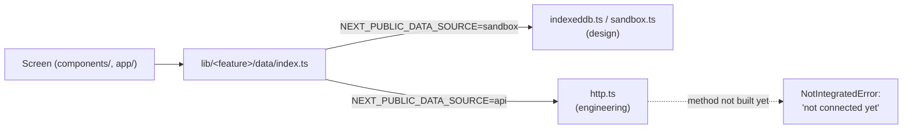

# Working in one repository

Design and engineering both work in `dristi-fe-develop`. One build setting decides whether
screens read demo data from the browser (the sandbox) or real data from the DRISTI backend,
and automated checks keep each team's code where it belongs.

This guide explains how that works and what it means day to day. The rules themselves are
in [AGENTS.md](../AGENTS.md) ("Data") and, in full, in
[.agents/policies/data-seam.md](../.agents/policies/data-seam.md). Who reviews what is in
[.github/CODEOWNERS](../.github/CODEOWNERS).

## Contents

1. [Why it works this way](#why-it-works-this-way)
2. [Two modes](#two-modes)
3. [Where a feature's data lives](#where-a-features-data-lives)
4. [Adding data a screen needs](#adding-data-a-screen-needs)
5. [Older features move first](#older-features-move-first)
6. [Loading, errors and "not connected yet"](#loading-errors-and-not-connected-yet)
7. [Checks, and what to do when one fails](#checks-and-what-to-do-when-one-fails)
8. [How a change reaches main](#how-a-change-reaches-main)
9. [What changes for the design team](#what-changes-for-the-design-team)
10. [What changes for engineering](#what-changes-for-engineering)
11. [Known limits](#known-limits)

## Why it works this way

Design and engineering used to work in two repositories and edit the same screen files for
different reasons: design changed how a screen looks, engineering changed where its data
comes from. Screens imported demo data and read browser storage directly, so connecting a
screen to the backend meant editing it, and every sync between the two repositories was a
large manual merge.

Now each feature keeps its data code behind a contract, and screens only call that
contract. Design changes the screen and the demo data; engineering changes the backend
calls. The two rarely touch the same file.

## Two modes

Two build-time settings, read in `apps/dristi-app/src/lib/data/source.ts`:

- `NEXT_PUBLIC_DATA_SOURCE`: where screens get their data. `sandbox` is the browser
  (IndexedDB, fixtures, demo seeding); `api` is the backend. When it is not set, the app
  uses `api`, so a build with nothing set never shows demo data from the features on the
  switch.
- `NEXT_PUBLIC_AUTH_SOURCE`: who answers sign-in. `sandbox` accepts any 6-digit code;
  `api` is the backend. When it is not set, it follows the data setting.

| How you run it                                                                               | Data    | Sign-in |
| -------------------------------------------------------------------------------------------- | ------- | ------- |
| `npm run dev:sandbox` (design work, demos)                                                   | sandbox | sandbox |
| `npm run dev` (engineering default, set in `.env.development`)                               | sandbox | api     |
| `npm run dev` with `NEXT_PUBLIC_DATA_SOURCE=api` in `apps/dristi-app/.env.development.local` | api     | api     |
| The published Docker image (staging)                                                         | sandbox | api     |
| `npm run build`, CI or Docker with nothing set                                               | api     | api     |
| Netlify design previews                                                                      | sandbox | sandbox |

`npm run dev:sandbox` prints a line saying both settings are in the sandbox. Next.js
still lists `.env.development` among the files it loaded; the settings from the script win
over that file.

Only tasks, e-filing and the cases list are on the switch so far. Other features still
read demo data directly in every mode until they move (see
[Older features move first](#older-features-move-first)).

## Where a feature's data lives

Each feature keeps its data in `apps/dristi-app/src/lib/<feature>/data/`:

| File                                 | What it is                                            | Owner                                     |
| ------------------------------------ | ----------------------------------------------------- | ----------------------------------------- |
| `repository.ts` (with `../types.ts`) | The contract: every read and write a screen may do    | Both teams. It only grows.                |
| `indexeddb.ts` or `sandbox.ts`       | The sandbox: demo data in the browser, seeding, reset | Design                                    |
| `http.ts`                            | The backend calls, one method at a time               | Engineering                               |
| `index.ts`                           | Picks one of the two by the data setting              | Both teams. Don't edit it once it exists. |

Screens get data only from the feature's store or hook (for example `useTasks()`) or from
`getRepository()`. They never import fixtures, sandbox code, `http.ts` or `@/lib/api`, and
never use browser storage for data. A UI preference, such as a remembered filter, uses
`useLocalStorageValue` from `@/hooks/use-local-storage-value`.

Start a new feature's data layer with `npm run new:data -- <feature>`. It writes the four
files the same way every time and never overwrites one.

## Adding data a screen needs

Follow this order:

1. Add or extend the type in `lib/<feature>/types.ts`.
2. Add a method to `data/repository.ts`, with a one-line comment on what it returns. A
   method never takes the signed-in person's id; the backend knows who is asking.
3. Answer it in the sandbox (`indexeddb.ts` or `sandbox.ts`).
4. Call it from the screen through the store, hook or `getRepository()`.

Design doesn't touch `http.ts`. In an `api` build the new method answers "not connected
yet" until engineering builds it, which is expected. List new methods and fields in the PR
under "Contract changes" so engineering can pick them up.

Contracts only grow. Adding a method, an optional field or a union value is always fine.
To rename or remove something, add the new one beside it, mark the old one
`/** @deprecated use X */`, and list it under "Contract changes"; removing it later needs
both teams.

## Older features move first

Vakalatnama, applications, employee and some other features still keep data in their own
browser-storage stores. Before one of them gets new data, its data moves behind a contract,
in a PR of its own:

1. `npm run new:data -- <feature> --move` starts a branch from `main`, writes the data layer
   and takes the old `store.ts` off the lint exception list.
2. The move PR changes nothing else: no new fields, no visual change. Its screens only gain
   loading and error states. Open it with the data-move template
   (`.github/PULL_REQUEST_TEMPLATE/data-move.md`).
3. New fields and redesigns come in later PRs, on top of the moved version.

A move done inside feature work collides with other people's screen changes, which is why
it goes first and alone. CI blocks the two shortcuts: new data in a feature that hasn't
moved, and new lines in its old store. A genuine fix to an old store that adds no data gets
the `old-store-fix` label from engineering.

## Loading, errors and "not connected yet"

Every screen handles loading, empty and error states, and one more: "not connected yet".
When a contract method has no backend version, it rejects with `NotIntegratedError`
("tasks.listPeople is not connected to the backend yet").

- Show "not connected yet" as a neutral state, not as a failure, and offer no Try again:
  asking again gets the same answer. `isNotIntegratedError(error)` from
  `@/lib/data/source` tells the two apart.
- Show translated copy on screen. The method name goes to the console or server log, for
  whoever connects it.
- Demo-only controls ("Viewing as", "Reset sandbox data", a "Sandbox: ..." payment or
  signing shortcut) render only when `IS_SANDBOX` from `@/lib/data/source` is true.

## Checks, and what to do when one fails

| Check                            | What it stops                                                                                                    | What you see                                                                                                                                                                                                     | What to do                                                                  |
| -------------------------------- | ---------------------------------------------------------------------------------------------------------------- | ---------------------------------------------------------------------------------------------------------------------------------------------------------------------------------------------------------------- | --------------------------------------------------------------------------- |
| Lint (`npm run lint`)            | A screen importing fixtures, sandbox code, `http.ts`, `lib/api`, server code or `idb`                            | `'@/lib/tasks/fixtures' import is restricted ... Use getRepository() or the feature's store/hook`                                                                                                                | Get the data through the store, hook or `getRepository()`                   |
| Lint                             | A screen using `localStorage`, `sessionStorage` or `indexedDB`, or `lib/` code using them outside a sandbox file | `'window.localStorage' is restricted ...`                                                                                                                                                                        | Data goes through a repository; a UI preference uses `useLocalStorageValue` |
| Type check (`npm run typecheck`) | A contract method renamed or removed while `http.ts` implements it                                               | `"http.ts implements a method the contract no longer has": "listTasks"`, reported in the feature's `data/index.ts`. If `http.ts` doesn't implement it yet, the errors show in the sandbox and the store instead. | Undo the rename, or add the new method beside the old one                   |
| `npm run check:lint-exceptions`  | A file added to a lint exception list, or a new list                                                             | `The lint exception lists only shrink`                                                                                                                                                                           | Fix the file instead of excusing it                                         |
| `npm run check:data-moves`       | New data in an older feature before its move                                                                     | `New data in vakalatnama, whose data layer isn't on origin/main yet`                                                                                                                                             | Move the feature first (`new:data -- <feature> --move`)                     |
| `npm run check:data-moves`       | An old store growing outside its move                                                                            | `Old store grew: ...`                                                                                                                                                                                            | Move first, or ask engineering for `old-store-fix` if it adds no data       |
| `npm run check:rails`            | `.agents/` edited without regenerating the copies for Claude, Cursor and Codex                                   | `Generated file differs: ...`                                                                                                                                                                                    | Run `npm run sync:rails`                                                    |

The two data checks compare with `origin/main` by default. Pass another ref to change that,
for example `npm run check:data-moves -- HEAD` to test uncommitted work.

Before opening a PR, run `npm run format:check`, `npm run lint`, `npm run typecheck` and
`npm run test:app`. For UI work, also run `npm run verify:ui` (see
[What changes for the design team](#what-changes-for-the-design-team)).

## How a change reaches main

1. Branch from the latest `main` (`feature/`, `fix/`, `chore/`, `docs/`) and keep the PR
   small.
2. Open a PR into `main` with the default template, or the data-move template for a move.
3. Two workflows run on every PR:
   - `ci.yml`: format check, lint, type check, unit tests, the agent rails check, the
     script tests and a production build.
   - `data-rules.yml`: the lint exception lists and the data-move checks, against the PR's
     base branch.
4. CODEOWNERS asks the right team to review each file:
   - design: screens, `content.ts` copy, the sandbox and demo data, design-system scripts,
     the agent files;
   - engineering: `http.ts`, `lib/api`, `lib/server`, `lib/data`, ESLint and Next config,
     both `package.json` files, `tsconfig.json`, Docker, CI;
   - either team: everything else, such as contracts, types, stores and `messages/*.json`.

   A PR that touches both kinds of file needs both teams.

5. It merges when CI is green and the owners approve.

## What changes for the design team

1. Work in `dristi-fe-develop`, on `feature/<name>` branches, with small PRs into `main`.
   `dristi-fe-design` is archived.
2. Run the app with `npm run dev:sandbox`.
3. `npm install` no longer downloads the design system. Run `npm run setup:ds` once, and
   again when the pin in `ds.lock.json` changes.
4. The design-system checks no longer run inside `npm run lint`, because CI and Docker
   don't have the design-system copy. Before a UI PR, run `npm run verify:ui`: it runs
   lint, every design-system check, the type check and the rails check. CI doesn't run the
   design-system checks, so this local run is the only one.
5. Copy lives in `apps/dristi-app/messages/en.json` (see [localization.md](localization.md)).
6. New data follows the order in [Adding data a screen needs](#adding-data-a-screen-needs).
   Screens never import fixtures or use browser storage; lint stops both.
7. Older features move their data first, in a PR of their own (see
   [Older features move first](#older-features-move-first)).
8. Engineering approves changes to `http.ts`, `lib/api`, CI, both `package.json` files and
   `tsconfig.json`.
9. After editing anything in `.agents/`, run `npm run sync:rails`. The root `AGENTS.md` is
   written by hand and shared by both teams; it isn't generated any more.
10. The in-app design mode overlay is gone (removed in PR #12). The `design-review` skill works
    from written feedback, screenshots or Pencil.

## What changes for engineering

1. Connect a feature by adding methods to its `http.ts`, never by editing a screen.
2. Only against endpoints the backend has. A missing endpoint stays "not connected yet";
   never guess a URL or turn a missing endpoint into an empty list.
3. A contract method engineering adds gets its sandbox answer in the same PR, and design
   reviews that part. When the backend behaves differently from the sandbox, update the
   sandbox too.
4. Review contract changes; design reviews the sandbox.
5. `npm run dev` keeps sandbox data with real sign-in. To see which screens already work
   against the backend, set `NEXT_PUBLIC_DATA_SOURCE=api` in
   `apps/dristi-app/.env.development.local`.
6. `npm install` no longer clones the design system.

## Known limits

- Two people editing the same screen can still conflict.
- 16 screens and 19 stores still bypass the switch. They are listed in
  `apps/dristi-app/eslint.config.mjs` and come off the lists as each feature moves.
- Case detail pages, court sign-in and the employee screens still show demo data in every
  build.
- The design-system checks run only locally.
- Lint can't catch everything: dynamic imports, data saved through `useLocalStorageValue`,
  and a few indirect ways to reach browser storage get past it. Reviews cover these.
